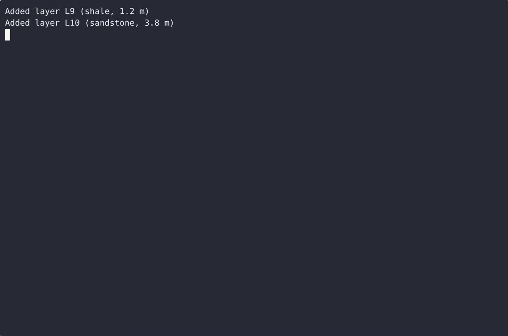
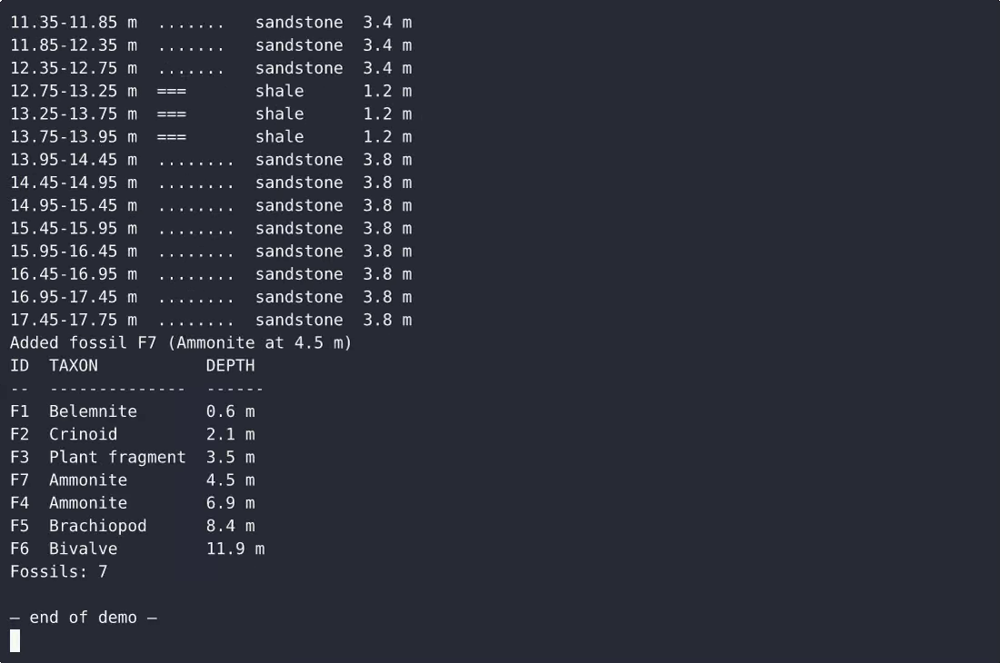

# LithoLog — complete Full-stack app command-line tool example app

Clone it. Run it. Own it. **LithoLog** is a complete, Apache-2.0-licensed command-line tool in Full-stack app — full source, demo data included. LithoLog is a single-file, standard-library-only Python CLI for field geologists: it logs rock layer descriptions (depth, thickness, lithology, name), renders those layers as a plain-text stratigraphic column, and reg…. Self-host LithoLog on your own infrastructure, or open it on [cenius.ai](https://cenius.ai/marketplace/p/litholog?ref=gh&utm_campaign=litholog-webapp) to request changes and get a LithoLog fresh build.


[](LICENSE)  [](https://cenius.ai)

[](https://cenius.ai/marketplace/p/litholog?ref=gh&utm_campaign=litholog-webapp)

> **▶ [Open & edit in cenius.ai](https://cenius.ai/marketplace/p/litholog?ref=gh&utm_campaign=litholog-webapp)** — one click to an editable workspace: describe changes in plain English, get an instant preview, one-click deploy and host. Modifications made on the platform come with full rebrand & relicense rights.

_Local clone? See [Quick start](#quick-start) below. cenius.ai is the zero-setup path._

## Demo


▶ **[Watch the full demo video](https://cenius.ai/marketplace/p/litholog?ref=gh&utm_campaign=litholog-webapp)** — the complete walkthrough, playing on the project's cenius.ai page · [MP4 file](.github/media/demo.mp4)

## Screenshots

 

## Features

- Rock layer description logger
- Stratigraphic column builder
- Fossil find register

## Architecture

The repository contains 14 files of Full-stack app source, organised under `tests/`. Run `./install.sh` once to install packages and populate demo data — the app is ready to use immediately after. Step-by-step setup guide: [`INSTALL.md`](INSTALL.md).

## Quick start

```bash
./install.sh   # installs dependencies + seeds demo data
```

See [`INSTALL.md`](INSTALL.md) for full setup and usage instructions.

## Usage guide

Everything is invoked as `litholog <group> <action> [flags]`; run
`python3 litholog.py <group> <action> --help` for the flags of any action. Every
transcript below is real output: the two-bed examples use a scratch store, and the
column walkthrough uses the eight-layer demo section `install.sh` seeds
(12.75 m total).

- [Layer register](#layer-register) - `layer add`, `layer list`
- [Stratigraphic column](#stratigraphic-column) - `column`
- [Fossil find register](#fossil-find-register) - `fossil add`, `fossil list`
- [Operator profile](#operator-profile) - `operator set`, `whoami`
- [Errors, exit codes and scripting](#errors-exit-codes-and-scripting)

### Layer register

Log a bed by describing it. The lithology must be one of the seven known
keywords, because the column needs exactly one glyph per lithology, and the
thickness must be a number of metres greater than zero.

```console
$ python3 litholog.py layer add --lithology shale --thickness 1.2 --description "fissile dark shale"
Added layer L1 (shale, 1.2 m)
$ python3 litholog.py layer add --lithology sandstone --thickness 3.8
Added layer L2 (sandstone, 3.8 m)
```

Ids are assigned for you (`L1`, `L2`, ...) and never reused - the register is
append-only. Read it back in insertion order, top of section first:

```console
$ python3 litholog.py layer list
ID  LITHOLOGY  THICKNESS  DESCRIPTION
--  ---------  ---------  ------------------
L1  shale      1.2 m      fissile dark shale
L2  sandstone  3.8 m      -
Layers: 2
```

_Full guide: [`USAGE.md`](USAGE.md)_

## FAQ

### Can I deploy LithoLog on my own infrastructure?

Clone this repository and run `./install.sh`, then start the app as described in [`INSTALL.md`](INSTALL.md). LithoLog is fully self-hostable — no external services are required to try it.

### Is white-labeling LithoLog allowed?

Absolutely. [Open it on cenius.ai](https://cenius.ai/marketplace/p/litholog?ref=gh&utm_campaign=litholog-webapp) and remix it there — platform modifications come with full rebrand and relicense rights over your derivative, so the result is entirely yours.

### How is LithoLog built technically?

Full-stack app end-to-end. Every file you need to run the app is here in this repository — code, configuration, seed data. Highlights include stratigraphic column builder.

### Is LithoLog editable without a developer?

[cenius.ai](https://cenius.ai/marketplace/p/litholog?ref=gh&utm_campaign=litholog-webapp) handles the implementation. Tell it what you want in everyday words, pick up the updated build. No coding needed.

### What license does LithoLog use?

The code is under the Apache-2.0 license, which allows commercial use without restriction. You can build, sell, and deploy it freely. Full text: [LICENSE](LICENSE).

## License & rebranding

Released under the [Apache License 2.0](LICENSE) (© 2026 Cenius AI) — free for personal and commercial use. The Cenius name/logo are trademarks (see NOTICE).

**Need a customized version?** [Remix this app on cenius.ai](https://cenius.ai/marketplace/p/litholog?ref=gh&utm_campaign=litholog-webapp) — modifications made on the platform come with **full rebrand & relicense rights** over your derivative.

## Built with cenius.ai

This entire application — code, design, seeded demo data — was generated on **[cenius.ai](https://cenius.ai)** from a plain-English description.

- 🚀 [Build your own app on cenius.ai](https://cenius.ai)
- 🎛️ [Remix LithoLog on the marketplace](https://cenius.ai/marketplace/p/litholog?ref=gh&utm_campaign=litholog-webapp) — open it in a workspace, prompt for changes, and ship your own version.

More open-source apps: [the Cenius-ai catalog](https://github.com/Cenius-ai) · [showcase index](https://github.com/Cenius-ai/showcase)
